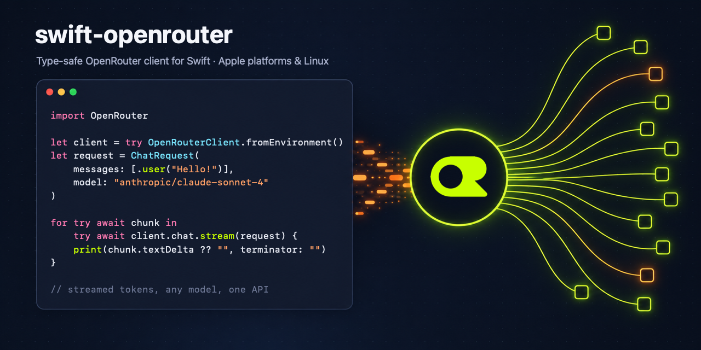

<p align="center">
  
</p>

<p align="center">
  <a href="https://github.com/telip007/swift-openrouter/actions/workflows/ci.yml"></a>
  
  
  <a href="LICENSE"></a>
</p>

# swift-openrouter

A Swift client for the [OpenRouter API](https://openrouter.ai/docs/api_reference/overview):
one API for hundreds of models across providers.

- **Generated from OpenRouter's OpenAPI spec**, so request and response types match
  the API exactly. The spec is patched for correctness (nullable fields, open enums).
- **An ergonomic layer on top:** message and tool builders, streaming with tool-call
  accumulation, typed errors, retries with backoff and `Retry-After`.
- **Swift 6, strict concurrency**, `Sendable` throughout, `async`/`await` and `AsyncSequence`.
- **Apple platforms and Linux:** URLSession on Apple platforms, AsyncHTTPClient on Linux,
  or bring your own transport.

> [!NOTE]
> Community project, not affiliated with or endorsed by OpenRouter, Inc.
> The OpenRouter name and logo are trademarks of OpenRouter, Inc.

## Installation

```swift
// Package.swift
dependencies: [
    .package(url: "https://github.com/telip007/swift-openrouter", from: "0.1.0"),
],
targets: [
    .target(name: "MyApp", dependencies: [
        .product(name: "OpenRouter", package: "swift-openrouter"),
    ]),
]
```

Requires Swift 6.2+ and macOS 15 / iOS 18 / tvOS 18 / watchOS 11 / visionOS 2, or Linux.

## Quick start

```swift
import OpenRouter

let openRouter = try OpenRouterClient.fromEnvironment() // reads OPENROUTER_API_KEY

let result = try await openRouter.chat.send(
    ChatRequest(
        messages: [.system("Be concise."), .user("What is OpenRouter?")],
        model: "openai/gpt-4o-mini"
    )
)
print(result.text ?? "")
print(result.usage?.totalTokens ?? 0, "tokens")
```

## Streaming

```swift
var accumulator = ChatStreamAccumulator()
for try await chunk in try await openRouter.chat.stream(request) {
    accumulator.add(chunk)
    print(chunk.textDelta ?? "", terminator: "")
}
// The complete assistant message, ready to append to the conversation:
let reply = accumulator.message
```

Keep-alive comments, the `[DONE]` sentinel and the final usage chunk are handled for you.
Errors that occur after streaming has started are thrown from the loop.
Cancelling the task closes the connection.

## Tools

```swift
let readFile = ChatTool.function(
    name: "read_file",
    description: "Read a UTF-8 text file",
    parameters: [
        "type": "object",
        "properties": ["path": ["type": "string"]],
        "required": ["path"],
    ]
)

var messages: [ChatMessage] = [.user("What's in README.md?")]
let result = try await openRouter.chat.send(
    ChatRequest(messages: messages, model: "anthropic/claude-sonnet-4", toolChoice: .auto, tools: [readFile])
)

if result.finishReason == FinishReason.toolCalls, let message = result.message {
    messages.append(.assistant(message))
    for call in result.toolCalls {
        struct Arguments: Decodable { var path: String }
        let path = try call.decodeArguments(as: Arguments.self).path
        messages.append(.tool(callID: call.id, content: try String(contentsOfFile: path, encoding: .utf8)))
    }
    // …send `messages` again for the model's answer.
}
```

Tool schemas are written as JSON literals (`JSONValue`). Tool choices are `.auto`,
`.required`, `.function("name")` and `.disabled` (`"none"` on the wire).

## Errors

API errors are thrown as `OpenRouterError`, whether they come as an HTTP status or are
reported after `200 OK` (mid-stream, or in a non-streaming body):

```swift
do {
    _ = try await openRouter.chat.send(request)
} catch let error as OpenRouterError {
    switch error.errorType { // OpenRouter's typed, provider-independent error code
    case "context_length_exceeded": break // trim the conversation
    case "rate_limit_exceeded": break     // already retried; error.retryAfter says how long to wait
    default: print(error.kind, error.statusCode, error.message)
    }
}
```

See OpenRouter's [errors and debugging](https://openrouter.ai/docs/api_reference/errors-and-debugging)
guide for the meaning of each code.

## Configuration

```swift
let openRouter = OpenRouterClient(
    apiKey: key,
    configuration: .init(
        appURL: "https://example.com",   // HTTP-Referer, for attribution on openrouter.ai
        appTitle: "My App",              // X-OpenRouter-Title
        retryPolicy: .init(maxElapsedTime: .seconds(30)), // or .disabled
        timeout: .seconds(120)
    ),
    transport: nil,      // custom ClientTransport, e.g. for tests
    middlewares: []      // e.g. logging
)
```

Retries use exponential backoff with jitter, honour `Retry-After`, and cover 429, 5xx and
transient network failures.

**Server-side Swift on macOS:** the default transport is URLSession on Apple platforms and
AsyncHTTPClient (SwiftNIO) on Linux. To use AsyncHTTPClient everywhere, add
[swift-openapi-async-http-client](https://github.com/swift-server/swift-openapi-async-http-client)
and pass `transport: AsyncHTTPClientTransport()`.

## Everything else

The convenience API covers chat, models, credits, generations and the current API key.
Every other generated operation is available on `openRouter.api`, with the same
authentication, retries and error mapping:

```swift
let providers = try await openRouter.api.listProviders().ok.body.json
```

The generated operations are a curated subset of the spec, chosen to keep build times
reasonable. Need another endpoint? Add its tag to
[`openapi/generator-config.yaml`](openapi/generator-config.yaml) and run `make generate`.
PRs are welcome.

## API keys in apps

Don't ship an API key inside an app binary. Use per-user keys via
[OAuth PKCE](https://openrouter.ai/docs/api_reference/authentication) or call OpenRouter
from your own backend.

## Contributing

See [CONTRIBUTING.md](CONTRIBUTING.md). In short: `make bootstrap`, then `make check`
before you push. Design notes, decisions and known gotchas live in the
[project wiki](wiki/index.md).

## License

[Apache 2.0](LICENSE).
